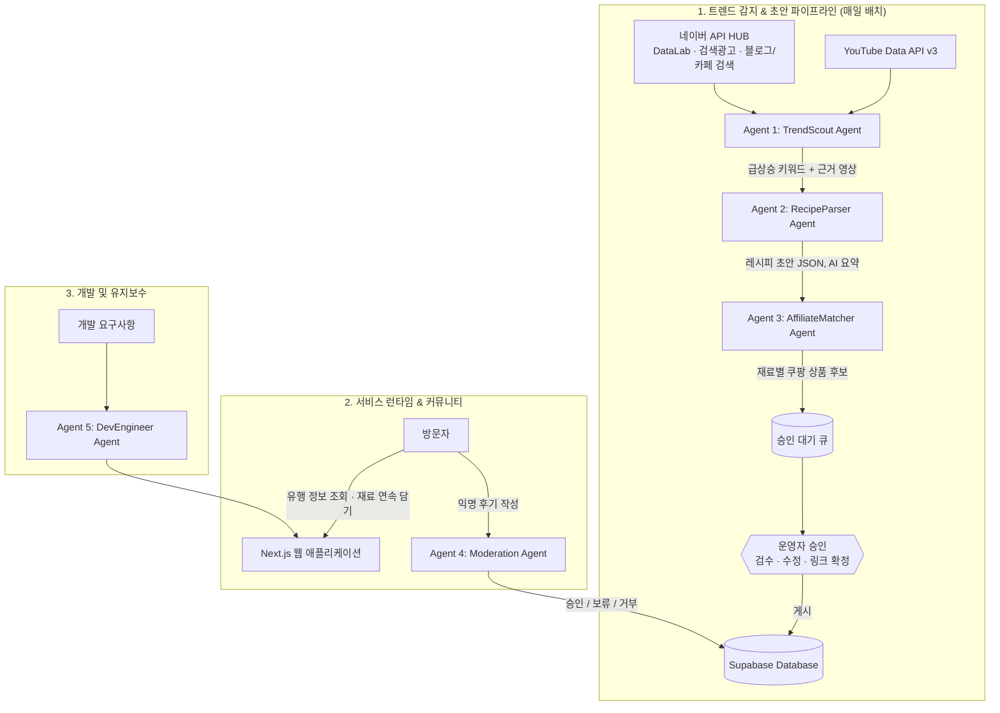

# 🤖 [AGENT] 트렌드푸드 AI 에이전트 시스템 가이드

> **문서 목적**: 유행 음식 감지, 레시피 초안 작성, 재료 링크 매칭, 익명 후기 검수, 서비스 개발을 담당하는 멀티 에이전트(Multi-Agent) 시스템 설계 및 프롬프트 명세서  
> **문서 버전**: v2.0 (2026-11-03) — `prd.md` v2.0 기준으로 개정  
> **핵심 원칙**: 공식 API만 사용 / 크롤링·자막 추출 금지 / **운영자 승인 후 게시** / 사용자 탭 1회 = 쿠팡 상품 1개

---

## 1. 멀티 에이전트 아키텍처 개요



---

## 2. 에이전트 상세 명세 (Agent Specifications)

### 2.1 Agent 1: TrendScout Agent (유행 감지 에이전트)
- **역할**: 네이버 검색 데이터로 급상승 음식 키워드를 찾고, YouTube에서 근거 영상을 찾아 후보로 묶음
- **입력 데이터**:
  - 네이버 DataLab 검색어 트렌드 (상대지수, **기준 키워드를 매 요청에 포함해 정규화**)
  - 네이버 검색광고 `keywordstool` 월간 검색량 (저볼륨 키워드 제거)
  - 네이버 블로그·카페 검색 글 수 증가
  - YouTube `search.list` 결과 (하루 100회 별도 쿼터 안에서, `publishedAfter` 최근 7일, `regionCode=KR`, `relevanceLanguage=ko`) + 요리 채널 화이트리스트 업로드 목록
- **급상승 점수 (내부 정렬 전용, 화면 노출 금지)**:
  $$\text{Rising Score} = w_1 \cdot \log_2\left(\frac{\text{이번 주 정규화 지수}}{\text{지난 주 정규화 지수}}\right) + w_2 \cdot z(\text{검색 지수}) + w_3 \cdot z(\text{근거 영상 조회수 증가})$$
  - 검색광고 월간 검색량이 기준 미만이면 제외. 가중치 $w$는 운영 데이터로 보정.
- **금지**: SNS·커뮤니티 크롤링, Instagram/TikTok 데이터 수집, 비공식 Trends 라이브러리
- **시스템 프롬프트 (Prompt Template)**:
```markdown
당신은 대한민국 음식 트렌드를 감지하는 분석가 에이전트입니다.
입력된 네이버 검색 지표와 YouTube 영상 메타데이터(제목·설명·조회수)를 보고
지금 급상승 중인 '유행 음식' 후보를 선별하세요.

[선별 기준]
1. 최근 7일 검색 지수가 지난주 대비 뚜렷하게 상승했을 것
2. 집에서 만들거나 편의점·마트에서 사서 즐길 수 있는 음식일 것
3. 근거 영상이 1개 이상 있을 것
4. 같은 음식을 가리키는 키워드는 하나로 묶을 것 (예: 두쫀쿠 = 두바이 쫀득쿠키)

[출력] 후보별 JSON: keyword, aliases, trend_reason(한 줄), evidence_video_ids, rising_score
```

---

### 2.2 Agent 2: RecipeParser Agent (레시피 초안 에이전트)
- **역할**: 근거 영상의 **제목·설명란·태그와 운영자 메모만** 보고 레시피 초안 JSON 작성
- **입력 금지**: 영상 자막·음성 (공식 API로 받을 수 없고 스크래핑은 약관 위반)
- **작성 원칙**:
  - 재료·분량·순서 같은 **사실만 추출해 새 문장으로 작성** (원문 문장 복사 금지)
  - 설명란에 정보가 부족하면 `needs_operator_input: true`로 표시하고 추측하지 않음
  - 재료를 핵심 재료(`is_key`) / 기본 양념(`is_pantry_staple`) / 선택 재료로 구분
  - 편의점·마트에서 즐기는 방법이 있으면 `store_version`에 작성
- **출력 JSON 스키마 예시**:
```json
{
  "title": "전자레인지 3분 대파 불고기 덮밥",
  "trend_reason": "자취 요리 쇼츠에서 확산, 최근 7일 검색량 2.3배",
  "category": ["초간단", "자취요리", "전자레인지"],
  "summary": "프라이팬 없이 그릇 하나로 끝내는 가성비 덮밥",
  "cooking_time_minutes": 10,
  "difficulty": "EASY",
  "servings": 1,
  "ingredients": [
    { "name": "대패 삼겹살", "amount": "150g", "is_required": true, "is_key": true, "is_pantry_staple": false, "search_keyword": "대패삼겹살 냉동" },
    { "name": "대파", "amount": "1대", "is_required": true, "is_key": false, "is_pantry_staple": false, "search_keyword": "깐대파" },
    { "name": "굴소스", "amount": "1 큰술", "is_required": true, "is_key": true, "is_pantry_staple": false, "search_keyword": "굴소스" },
    { "name": "참기름", "amount": "0.5 큰술", "is_required": false, "is_key": false, "is_pantry_staple": true, "search_keyword": "참기름" }
  ],
  "steps": [
    { "step": 1, "instruction": "대파를 송송 썰어 내열 용기 바닥에 깝니다." },
    { "step": 2, "instruction": "대패 삼겹살을 올리고 굴소스를 골고루 뿌립니다." },
    { "step": 3, "instruction": "랩을 씌워 구멍을 낸 뒤 전자레인지에 3분 30초 돌립니다." }
  ],
  "tips": ["랩은 헐렁하게 덮어야 기름이 덜 튑니다."],
  "store_version": null,
  "source_platform": "youtube",
  "source_url": "https://youtube.com/shorts/xxxxxx",
  "creator_name": "자취요리신",
  "ai_generated": true,
  "needs_operator_input": false
}
```

---

### 2.3 Agent 3: AffiliateMatcher Agent (재료 링크 매칭 에이전트)
- **역할**: 재료별 쿠팡 상품 후보를 제안하고, 운영자가 확정하면 파트너스 링크로 저장
- **단계별 동작**:
  - **Phase 1 (API 승인 전)**: `search_keyword`로 운영자용 검색 안내만 생성. 운영자가 쿠팡 파트너스 화면에서 링크를 직접 만들어 관리자 화면에 등록.
  - **Phase 3 (누적 판매 15만원 + 최종 승인 후)**: 쿠팡 파트너스 API 상품 검색 → 후보 3개 추천 → 운영자 확정 → 딥링크 생성 (`subId` = 레시피 ID).
- **추천 우선순위**:
  1. 로켓배송 / 로켓프레시 여부 (한 번에 묶어 받기)
  2. 1~2인용 소용량 옵션
  3. 평점·리뷰 수가 충분한 상품
- **제약**:
  - API 호출 한도가 출처마다 달라(분당 50회 vs 시간당 10회) 보수적으로 호출하고 결과를 캐시. 초과 시 계정 제한 위험.
  - 참고 가격은 **갱신 시각과 함께** 저장하고 화면에 기준 시각 표시.
  - 다른 쇼핑몰과의 최저가 비교·분산 링크는 하지 않음.

---

### 2.4 Agent 4: Moderation Agent (익명 후기 클린봇) — Phase 2
> prd.md v2.1: 익명 후기는 사용자 확보 후 도입하므로 이 에이전트도 Phase 2에 만든다.

- **역할**: 비회원 익명 후기의 욕설, 비방, 광고 스팸, 개인정보(전화번호 등) 검출
- **처리 순서 (비용 절감)**:
  1. 금칙어 사전·정규식 1차 필터 (전화번호, URL, 텔레그램 등)
  2. 애매한 글만 LLM 판정
  3. 신고 3회 이상 누적 시 자동 임시조치 → 운영자 검토
- **판정 규칙**:
  - `APPROVED`: 맛 평가, 대체 재료 팁, 실패기 등 정상 후기
  - `PENDING`: 판단이 애매함 → 운영자 검토
  - `REJECTED`: 욕설, 광고·불법 링크, 도배, 개인정보 노출
- **응답 형식**:
```json
{
  "status": "APPROVED",
  "reason": "정상 후기 (대체 재료 팁 포함)",
  "toxic_score": 0.02
}
```
- **참고**: 한국어 혐오표현 데이터셋(UnSmile 등)은 상업 이용 시 라이선스 확인 필요.

---

### 2.5 Agent 5: DevEngineer Agent (개발 및 코딩 가이드)

프로젝트 개발을 담당하는 AI 개발자가 지켜야 할 핵심 규약입니다.

#### [데모 UI 사용 원칙]
- 루트의 `index.html`은 **화면 구성·배치 참고용**입니다. HTML/JS 코드, 목업 데이터, 반응형 테스트 툴바, 원클릭 장바구니 모달(`openCoupangBridgeModal` 등)은 **가져오지 않습니다**.
- 레이아웃은 `prd.md` 5장 구성도(v2.1 포토 피드형: 사진 히어로 / 상단 칩 필터 / 한 줄에 하나씩 사진 카드 / 상세 2컬럼)를 기준으로 컴포넌트를 새로 작성합니다. 시각 기준은 `design/mockups/`.

#### [기술 스택 & 컨벤션]
- **Framework**: Next.js (App Router), TypeScript, Tailwind CSS
- **컴포넌트 라이브러리**: shadcn/ui, Lucide-react 아이콘
- **상태 관리**:
  - 재료 체크·"집에 있어요"·연속 담기 진행·찜: 클라이언트 `localStorage` (로그인 없음)
  - 서버 데이터: Server Components 우선, 필요 시 TanStack Query
- **모바일 우선 UX**: 큰 체크박스, 하단 고정 CTA
- **광고 슬롯**: `AdSlot` 컴포넌트로 통일. 높이 사전 확보(CLS 방지), 라우트 이동 시 재로드, 장바구니 CTA·체크리스트 주변 배치 금지.
- **표시 의무**: 대가성 문구 컴포넌트(장바구니 상단), "AI 요약" 배지(레시피 카드·상세).

#### [다음 재료 연속 담기 구현 패턴]
```typescript
// 사용자가 버튼을 탭할 때마다 상품 1개만 새 창으로 연다. 자동·일괄 오픈 금지.
export interface CartIngredient {
  id: string;
  name: string;
  amount: string;
  affiliateUrl: string;   // 쿠팡 파트너스 링크 (subId = 레시피 ID)
  productName: string;
  approxPrice: number | null;
  priceCheckedAt: string | null;
}

const progressKey = (recipeId: string) => `tf:cart-progress:${recipeId}`;

export function getOpenedIds(recipeId: string): string[] {
  try {
    return JSON.parse(localStorage.getItem(progressKey(recipeId)) ?? '[]');
  } catch {
    return [];
  }
}

// "장보기 시작" / "다음 재료 →" 버튼의 onClick 핸들러에서만 호출
export function openNextIngredient(recipeId: string, items: CartIngredient[]): CartIngredient | null {
  const opened = getOpenedIds(recipeId);
  const next = items.find((item) => !opened.includes(item.id));
  if (!next) return null;

  window.open(next.affiliateUrl, '_blank', 'noopener');
  try {
    localStorage.setItem(progressKey(recipeId), JSON.stringify([...opened, next.id]));
  } catch {
    // 저장 실패 시에도 링크 이동은 유지
  }
  return next;
}
```

---

## 3. 데이터베이스 ERD 구조 (PostgreSQL / Supabase)

```sql
-- 1. 급상승 키워드 테이블 (TrendScout 결과)
CREATE TABLE trend_keywords (
  id UUID PRIMARY KEY DEFAULT gen_random_uuid(),
  keyword VARCHAR(100) NOT NULL,
  aliases JSONB,                  -- ["두쫀쿠", "두바이 쫀득쿠키"]
  search_index NUMERIC,           -- 기준 키워드로 정규화한 지수
  monthly_search_volume INT,      -- 검색광고 API 절대 검색량
  rising_score NUMERIC,           -- 내부 정렬 전용 (화면 노출 금지)
  detected_at TIMESTAMPTZ DEFAULT NOW()
);

-- 2. 레시피(유행 음식) 마스터 테이블
CREATE TABLE recipes (
  id UUID PRIMARY KEY DEFAULT gen_random_uuid(),
  trend_keyword_id UUID REFERENCES trend_keywords(id),
  status VARCHAR(20) NOT NULL DEFAULT 'DRAFT', -- 'DRAFT', 'APPROVED', 'PUBLISHED', 'TAKEN_DOWN'
  title VARCHAR(255) NOT NULL,
  trend_reason TEXT,              -- 왜 뜨는지
  category VARCHAR(50) NOT NULL,
  tags JSONB,
  cooking_time INT NOT NULL,      -- 분 단위
  difficulty VARCHAR(20) NOT NULL, -- 'EASY', 'NORMAL', 'HARD'
  servings INT,
  thumbnail_url TEXT,             -- 자체 이미지만 (타 플랫폼 썸네일 저장 금지)
  store_version TEXT,             -- 편의점·마트에서 사는 버전
  steps JSONB NOT NULL,
  tips JSONB,
  ai_generated BOOLEAN DEFAULT TRUE, -- "AI 요약" 표시 여부
  like_count INT DEFAULT 0,
  view_count INT DEFAULT 0,
  published_at TIMESTAMPTZ,
  created_at TIMESTAMPTZ DEFAULT NOW(),
  updated_at TIMESTAMPTZ DEFAULT NOW()
);

-- 3. 출처 영상 테이블 (임베드 + 통계 30일 갱신)
CREATE TABLE recipe_sources (
  id UUID PRIMARY KEY DEFAULT gen_random_uuid(),
  recipe_id UUID REFERENCES recipes(id) ON DELETE CASCADE,
  platform VARCHAR(20) NOT NULL,  -- 'youtube', 'instagram', 'tiktok'
  source_url TEXT NOT NULL,
  video_id VARCHAR(100),
  creator_name VARCHAR(100),
  view_count BIGINT,              -- YouTube 원본 수치 (출처와 함께 표시)
  stats_refreshed_at TIMESTAMPTZ  -- 30일 경과 전 재갱신 또는 삭제
);

-- 4. 재료 & 쿠팡 링크 테이블
CREATE TABLE recipe_ingredients (
  id UUID PRIMARY KEY DEFAULT gen_random_uuid(),
  recipe_id UUID REFERENCES recipes(id) ON DELETE CASCADE,
  sort_order INT NOT NULL DEFAULT 0,
  name VARCHAR(100) NOT NULL,
  amount VARCHAR(50) NOT NULL,
  is_required BOOLEAN DEFAULT TRUE,
  is_key BOOLEAN DEFAULT FALSE,          -- 핵심 재료 강조
  is_pantry_staple BOOLEAN DEFAULT FALSE, -- 기본 양념 ("집에 있어요" 기본 후보)
  search_keyword VARCHAR(100),
  affiliate_product_name VARCHAR(255),
  affiliate_url TEXT,                    -- 운영자 확정 전에는 NULL
  approx_price INT,
  price_checked_at TIMESTAMPTZ,          -- 화면에 가격 기준 시각 표시
  created_at TIMESTAMPTZ DEFAULT NOW()
);

-- 5. 익명 후기 테이블 (Phase 2에 생성)
CREATE TABLE anonymous_reviews (
  id UUID PRIMARY KEY DEFAULT gen_random_uuid(),
  recipe_id UUID REFERENCES recipes(id) ON DELETE CASCADE,
  nickname VARCHAR(50) NOT NULL,
  password_hash VARCHAR(255) NOT NULL,  -- 수정/삭제용 4자리 비번 해시
  ip_hash VARCHAR(64) NOT NULL,         -- 도배·중복 평점 방지용, 단기 보관
  badge VARCHAR(30) NOT NULL,           -- 'LIFE_RECIPE', 'DELICIOUS', 'SOSO', 'FAILED'
  rating INT CHECK (rating BETWEEN 1 AND 5),
  content TEXT NOT NULL,
  tip_content TEXT,
  like_count INT DEFAULT 0,
  status VARCHAR(20) NOT NULL DEFAULT 'PENDING', -- 'APPROVED', 'PENDING', 'REJECTED', 'BLINDED'(임시조치)
  created_at TIMESTAMPTZ DEFAULT NOW()
);

-- 6. 신고 테이블 (정보통신망법 임시조치 기록)
CREATE TABLE review_reports (
  id UUID PRIMARY KEY DEFAULT gen_random_uuid(),
  review_id UUID REFERENCES anonymous_reviews(id) ON DELETE CASCADE,
  reason VARCHAR(50) NOT NULL,
  reporter_ip_hash VARCHAR(64) NOT NULL,
  handled_at TIMESTAMPTZ,
  created_at TIMESTAMPTZ DEFAULT NOW()
);
```

---

## 4. 실행 및 자동화 워크플로우

1. **매일 오전 06:00 (Cron)**:
   - `TrendScout Agent`가 네이버 지표와 YouTube 근거 영상으로 급상승 후보 5~10개 선정.
2. **오전 06:20**:
   - `RecipeParser Agent`가 후보별 레시피 초안 JSON 작성 (제목·설명란·태그만 사용).
3. **오전 06:40**:
   - `AffiliateMatcher Agent`가 재료별 상품 후보·검색 안내 생성 → 승인 대기 큐 등록.
4. **오전 (운영자)**:
   - 관리자 화면에서 초안 검수·수정, 재료 링크 확정 → 게시. 급상승 순위 재계산.
5. **매일 야간**:
   - 출처 영상 통계 갱신 (30일 경과 전), 참고 가격 갱신(API 승인 후).
6. **실시간 상시 동작**:
   - 방문자가 유행 정보 열람 → 재료 연속 담기 → 쿠팡 커미션 / 페이지 광고 노출 → 애드센스 수익.
   - 익명 후기 작성 시 `Moderation Agent` 검수 후 반영.
